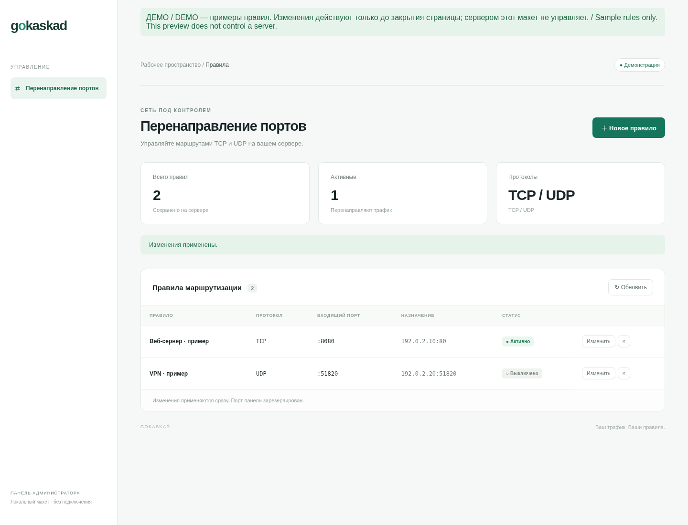

# Gokaskad

[Русский](#русский) · [English](#english)

## Русский

**Gokaskad — простая веб-панель для перенаправления TCP/UDP-портов на Linux-сервере.**

Например: соединение с портом `8080` вашего сервера отправляется на
`192.0.2.10:80`. Правила можно создавать, изменять, включать, выключать и удалять
в браузере. Они сохраняются и восстанавливаются после перезапуска.

### Установка одной командой

Нужен сервер с Debian/Ubuntu и root-доступом. Установщик установит Docker и
Docker Compose, если их ещё нет.

```bash
curl --proto '=https' --tlsv1.2 -fsSL https://raw.githubusercontent.com/naum-mm/go-kaskad/main/install.sh | sudo bash
```

Установщик спросит только:

1. **Пароль администратора** — от 12 символов, до 72 байт.
2. **Порт панели** — по умолчанию `8443`.

Откройте `https://IP-сервера:ПОРТ`. Логин: **`admin`**.
HTTPS-сертификат создаётся автоматически. Он самоподписанный: сверьте выведенный
установщиком отпечаток и добавьте сертификат в доверенные.
Если у сервера есть firewall или security group, разрешите выбранный порт панели
и порты, которые хотите перенаправлять.

### Как устроено

- **nginx** — единственная внешняя точка входа: HTTPS и пароль.
- **GUI** — веб-панель управления правилами.
- **API** — работает во внутренней Docker-сети, без внешнего порта.
- **Worker** — вызывает JSON-режим CLI и применяет правила iptables.
- **SQLite** — хранит правила в Docker volume, не имеет сетевого порта.

Worker получает задания через Unix-сокет и не слушает TCP/UDP. Он управляет
firewall хоста с `CAP_NET_ADMIN`, без privileged-режима и Docker socket.
Панель управляет своими цепочками; старые правила CLI автоматически не импортируются.
OpenBSD-скрипт остаётся отдельным CLI, веб-панель предназначена для Linux.

[Подробная инструкция: запуск, данные, обновления и тесты](docs/web.ru.md)

### Посмотреть макет без установки



[Мобильный вид](docs/panel-mobile.png) · [Скачать автономный HTML-макет](docs/preview.html)

На странице HTML-файла нажмите **Download raw file**, сохраните `preview.html`
и откройте его в браузере. Интернет, Docker и сервер не нужны. Это демонстрация:
правила в ней — примеры, изменения действуют только до закрытия страницы.
GitHub показывает исходный HTML, поэтому обычная ссылка на файл не открывает сайт.

### Если панель не открывается

Ошибка **“The plain HTTP request was sent to HTTPS port”** означает, что адрес
открыт через `http://`. Используйте **`https://IP-сервера:ПОРТ`**.
В новой версии HTTP на порту панели автоматически перенаправляется на HTTPS.
Для уже установленной версии выполните на сервере:

```bash
cd /opt/go-kaskad/current
sudo cp web/nginx/nginx.conf web/nginx/nginx.conf.bak
sudo curl -fsSL https://raw.githubusercontent.com/naum-mm/go-kaskad/main/web/nginx/nginx.conf -o web/nginx/nginx.conf
sudo docker compose exec -T nginx nginx -t && sudo docker compose restart nginx
```

Пароль, порт и правила сохранятся. Предупреждение о самоподписанном сертификате
возможно и после перенаправления; сверьте отпечаток из установщика.

### Удаление с сервера

**Удаляются все правила панели, база данных, пароль и сертификат. Восстановление
возможно только из вашей резервной копии.**

```bash
curl --proto '=https' --tlsv1.2 -fsSL https://raw.githubusercontent.com/naum-mm/go-kaskad/main/uninstall.sh | sudo bash
```

Скрипт остановит контейнеры и удалит их вместе с volume базы, сетями, образами
приложения, цепочками `GK_*`, настройкой Gokaskad в sysctl и каталогом
`/opt/go-kaskad`. Общие пакеты системы и Docker останутся.

Для новой установки, которая сохранила список добавленных пакетов, вместо
обычного удаления можно выбрать полную очистку:

```bash
curl --proto '=https' --tlsv1.2 -fsSL https://raw.githubusercontent.com/naum-mm/go-kaskad/main/uninstall.sh | sudo bash -s -- --remove-packages
```

Этот режим дополнительно удалит только пакеты, которых не было до установки.
Если Docker используется другими приложениями или удаление затрагивает чужие
пакеты, очистка пакетов остановится и сохранит список в `install-state`.
Общий кэш сборки Docker не очищается: он может использоваться другими проектами.
Для старых установок список пакетов и прежнее значение IP forwarding неизвестны;
скрипт не угадывает их. Приложение удаляется обычной командой, а общие пакеты можно
проверить по `/var/log/apt/history.log` и удалить отдельно, если они больше не нужны.

## English

**Gokaskad is a simple web panel for forwarding TCP/UDP ports on a Linux server.**

For example, a connection to port `8080` on your server is forwarded to
`192.0.2.10:80`. Create, edit, enable, disable, and delete rules in your browser.
Rules are saved and restored after a restart.

### One-command installation

Use a Debian/Ubuntu server with root access. The installer installs Docker and
Docker Compose if they are missing.

```bash
curl --proto '=https' --tlsv1.2 -fsSL https://raw.githubusercontent.com/naum-mm/go-kaskad/main/install.sh | sudo bash
```

The installer asks for just:

1. **Admin password** — at least 12 characters, up to 72 bytes.
2. **Panel port** — `8443` by default.

Open `https://SERVER-IP:PORT`. Username: **`admin`**.
An HTTPS certificate is generated automatically. It is self-signed: verify the
fingerprint printed by the installer and trust the certificate.
If your server has a firewall or security group, allow the selected panel port
and the ports you want to forward.

### How it works

- **nginx** — the only public entry point, with HTTPS and password protection.
- **GUI** — the rule management interface.
- **API** — runs on an internal Docker network, with no published port.
- **Worker** — calls the CLI's JSON interface to apply iptables rules.
- **SQLite** — stores rules in a Docker volume and has no network port.

The worker accepts jobs through a Unix socket and has no TCP/UDP listener. It
manages the host firewall with `CAP_NET_ADMIN`, without privileged mode or a
Docker socket. The panel manages its own chains; existing CLI rules are not
imported automatically. The OpenBSD script remains a separate CLI; the web panel
requires Linux.

[Detailed web guide (Russian)](docs/web.ru.md) · [Original CLI guide (English)](docs/cli.en.md)

### Preview without installing

[Desktop preview](docs/panel-preview.png) · [Mobile preview](docs/panel-mobile.png) · [Standalone HTML demo](docs/preview.html)

Open the HTML file on GitHub, choose **Download raw file**, save `preview.html`,
and open it in your browser. No Internet connection, Docker, or server is needed.
The demo contains sample rules; changes last only until the page is closed.
GitHub displays HTML source rather than running it as a website.

### Connection error after installation

**“The plain HTTP request was sent to HTTPS port”** means the address was opened
using `http://`. Use **`https://SERVER-IP:PORT`**. New installations redirect HTTP
to HTTPS automatically. To fix an existing installation without losing data:

```bash
cd /opt/go-kaskad/current
sudo cp web/nginx/nginx.conf web/nginx/nginx.conf.bak
sudo curl -fsSL https://raw.githubusercontent.com/naum-mm/go-kaskad/main/web/nginx/nginx.conf -o web/nginx/nginx.conf
sudo docker compose exec -T nginx nginx -t && sudo docker compose restart nginx
```

Your password, port, and rules are preserved. The browser may still show a
self-signed certificate warning; verify the installer's certificate fingerprint.

### Uninstall

**This deletes the panel's rules, database, password, and certificate. You need
your own backup to restore them.**

```bash
curl --proto '=https' --tlsv1.2 -fsSL https://raw.githubusercontent.com/naum-mm/go-kaskad/main/uninstall.sh | sudo bash
```

Removes containers, the database volume, project networks and application images,
`GK_*` firewall chains, the project's sysctl setting, and `/opt/go-kaskad`.
Shared system packages and Docker remain installed.

For a new installation with a saved package manifest, choose this instead to
also remove packages introduced by the installer:

```bash
curl --proto '=https' --tlsv1.2 -fsSL https://raw.githubusercontent.com/naum-mm/go-kaskad/main/uninstall.sh | sudo bash -s -- --remove-packages
```

Package removal stops if other Docker resources remain or unrelated packages
would be removed. Shared Docker build cache is preserved. Older installations
did not record their package baseline or original IP forwarding value: use the
regular uninstall command, then review `/var/log/apt/history.log` before removing
any shared packages manually.
